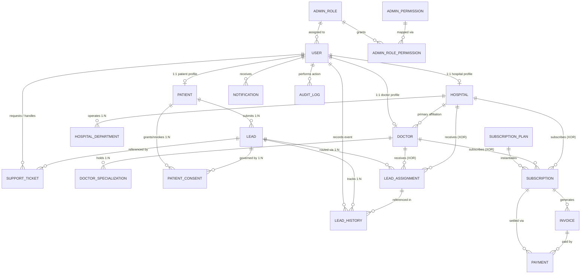

# Entity Relationships

> **Source of Truth:** `frontend/prisma/schema.prisma` (20 SQLite models)

## 1. Complete Entity-Relationship Diagram

---

## 2. Cardinality & Foreign Key Policies

### 2.1 Identity & Administrative RBAC
- **`User` → `AdminRole` (N:1 Optional):** A `User` with an administrative role (`SUPER_ADMIN`, `OPERATIONS_ADMIN`, `FINANCE_ADMIN`, `SUPPORT_ADMIN`) references an active `AdminRole` via `adminRoleId` (`onDelete: SetNull`). Non-admin users (`PATIENT`, `DOCTOR`, `HOSPITAL`) keep `adminRoleId = NULL`.
- **`AdminRole` ↔ `AdminPermission` (M:N via `AdminRolePermission`):** Cascades deletion of join rows when an `AdminRole` or `AdminPermission` is deleted (`onDelete: Cascade`).

### 2.2 User Profiles & Healthcare Providers
- **`User` ↔ `Patient` / `Doctor` / `Hospital` (1:1 Optional):** Each profile carries a `@unique` `userId` foreign key referencing `User(id)` with `onDelete: Restrict`. Account archival uses `User.deletedAt` and `archivedAt` rather than cascading destruction.
- **`Hospital` → `HospitalDepartment` (1:N):** One `Hospital` operates multiple clinical departments (`onDelete: Cascade`).
- **`Doctor` → `DoctorSpecialization` (1:N):** One `Doctor` holds multiple specializations (`onDelete: Cascade`).
- **`Hospital` → `Doctor` (1:N Optional):** A `Doctor` may optionally affiliate with a primary `Hospital` (`primaryHospitalId`, `onDelete: SetNull`).
- **Verification Attribution:** `Doctor.verifiedByUserId` and `Hospital.verifiedByUserId` link to the reviewing admin `User` (`onDelete: SetNull`).

### 2.3 Lead Lifecycle & Consent Relationships
- **`Patient` → `Lead` (1:N):** One `Patient` can submit multiple enquiries (`onDelete: Restrict`).
- **`Lead` → `LeadAssignment` (1:N):** A `Lead` can have multiple assignment attempts across time (`onDelete: Restrict`).
  - **Exclusive Arc Provider Link:** Each `LeadAssignment` identifies its receiving provider via `providerType` (`DOCTOR` | `HOSPITAL`) and sets **either** `doctorId` or `hospitalId` (both `onDelete: Restrict`). SQLite `CHECK` constraints enforce exclusivity, and partial unique indexes prevent duplicate `PENDING` or `ACCEPTED` assignments for the same `(leadId, provider)`.
- **`Lead` → `LeadHistory` (1:N):** Tracks every lead qualification, consent, assignment, acceptance, rejection, and closure event (`onDelete: Restrict`). Optional link to `LeadAssignment` (`onDelete: SetNull`) and `User` actor (`onDelete: SetNull`).
- **`Patient` + `Lead` → `PatientConsent` (1:N):** A `Lead` is governed by explicit `PatientConsent` records (`onDelete: Restrict`). Optional `authorizedDoctorId` / `authorizedHospitalId` restrict provider-specific consent scopes (`onDelete: Restrict`).

### 2.4 Billing & Support
- **`SubscriptionPlan` → `Subscription` (1:N):** Plans cannot be hard-deleted while subscriptions exist (`onDelete: Restrict`).
- **`Doctor` / `Hospital` → `Subscription` (1:N XOR):** Exclusive provider ownership enforced via SQLite `CHECK` constraints.
- **`Subscription` → `Invoice` → `Payment` (1:N):** Preserves full financial traceability (`onDelete: Restrict` across all billing links).
- **`User` → `Notification` (1:N):** In-app/outbound notifications cascade on user removal (`onDelete: Cascade`).
- **`User` / `Lead` → `SupportTicket` (1:N):** Requester relation uses `onDelete: Restrict`; assigned admin and optional `leadId` use `onDelete: SetNull`.
- **`User` → `AuditLog` (1:N):** `actorUserId` uses `onDelete: SetNull` so audit entries outlive user lifecycle transitions.
