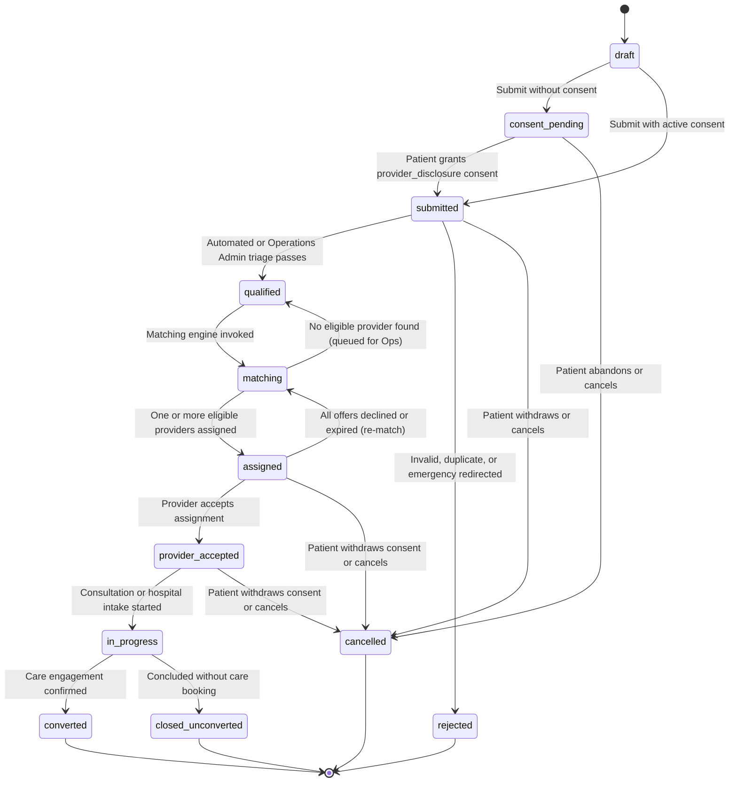

# Lead Generation, Qualification, Matching & Assignment Workflow

> **Governing Tables:** `consent_policies`, `patient_consents`, `leads`, `lead_assignments`, `lead_history`, `subscriptions`, `notifications`, `audit_logs`

## 1. Lead Lifecycle State Machine

### Assignment Lifecycle States (`assignment_status`)

- `pending_acceptance` — Offer dispatched to eligible doctor or hospital with hard SLA deadline `expires_at`.
- `accepted` — Provider accepted lead; consumes 1 lead quota unit from `subscriptions.leads_consumed_in_period` atomically.
- `declined` — Provider explicitly declined with `decline_reason`; provider excluded from future auto-match on the same lead.
- `expired` — SLA window elapsed without response; background sweeper marks expired and triggers cascade re-matching.
- `revoked` — Cancelled by patient consent withdrawal or Operations Admin override.
- `completed` — Associated lead reached `converted` or `closed_unconverted`.

---

## 2. Step-by-Step End-to-End Workflow

### Step 1: Lead Capture & Validation (`POST /api/v1/leads`)
1. Authenticated `patient` (with `account_status = 'active'`) submits enquiry details:
   - `specialization_id` (must reference an active `specializations` row)
   - `urgency` (`routine`, `soon`, `urgent`, `emergency_redirected`)
   - `consultation_mode` (`in_person`, `teleconsultation`, `both`)
   - Location (`preferred_city`, `preferred_state`, `country_code`, optional coordinates + `max_distance_km`)
   - `chief_complaint_summary`, optional `clinical_context_notes`, `age_bracket`, optional budget bounds + ISO currency
   - Mandatory `Idempotency-Key` header / `idempotency_key` enforced via `uq_leads_patient_idempotency`.
2. **Emergency Safety Screening:** If clinical screening flags life-threatening emergency symptoms or `urgency = 'emergency_redirected'`, the platform must display immediate emergency services notice and mark the lead `rejected` / `emergency_redirected` rather than routing through asynchronous lead matching.

### Step 2: Explicit Patient Consent Gate (`patient_consents`)
1. Before a lead can transition from `consent_pending` to `submitted` (or any downstream status), the database constraint `chk_lead_consent_gate` requires a valid `leads.consent_id`.
2. The patient reviews the active `consent_policies` version (`consent_type = 'provider_disclosure'`) and grants explicit consent (`max_provider_disclosures`, e.g., up to 3 providers), recording `granted_at`, `ip_hash`, and `user_agent_hash`.
3. Only after consent verification succeeds does the lead enter `submitted` and record `lead_history`.

### Step 3: Qualification & Triage
1. **Automated Pre-Checks:**
   - Active `patient_consents` verified (`status = 'granted'`, `withdrawn_at IS NULL`, unexpired).
   - Valid active `specialization_id` and complete geographic criteria (for `in_person`).
   - Duplicate/spam check against recent active enquiries by the same patient for the same specialization.
2. **Manual Triage Override (`operations_admin`):**
   - High-urgency (`urgent`) or ambiguous clinical enquiries can be reviewed by an `operations_admin`, who sets `qualified_at` and `qualified_by` or rejects with `rejection_reason`.
   - Every transition appends an immutable row to `lead_history`.

### Step 4: Provider Eligibility Filter & Matching Engine
When a lead enters `matching`, the backend `MatchingService` identifies eligible candidates across both **Doctors** and **Hospitals** (`hospital_departments`):

#### Hard Eligibility Filters (All Must Pass)
1. **Verification:** `verification_status = 'verified'` and owning `users.account_status = 'active'`.
2. **License Validity (Doctors):** `license_expires_at IS NULL OR license_expires_at > CURRENT_DATE`.
3. **Intake Flag:** `is_accepting_leads = TRUE` (and for hospitals, matching `hospital_departments.is_active = TRUE AND is_accepting_leads = TRUE`).
4. **Specialization Match:** Doctor holds matching `doctor_specializations.specialization_id` (or subspecialty parent match), OR Hospital operates matching `hospital_departments.specialization_id`.
5. **Care Setting Compatibility:**
   - If lead requests `teleconsultation`, provider supports `teleconsultation` or `both` (doctors) / `offers_teleconsultation = TRUE` (hospitals).
   - If lead requests `in_person`, provider matches geographic jurisdiction (`country_code`, state/city or `max_distance_km` radius).
6. **Active Subscription & Remaining Quota:**
   - Provider holds an active `subscriptions` record (`status IN ('active', 'trialing')`, `current_period_end > NOW()`, `leads_consumed_in_period < leads_allocated_in_period`).
7. **Cooldown / Exclusion:**
   - Provider has no existing active, declined, or revoked `lead_assignments` row for the same `lead_id`.
8. **Disclosure Cap:**
   - Active/accepted assignment count for `lead_id` is strictly below `patient_consents.max_provider_disclosures`.

#### Deterministic Match Scoring (`0.00` – `100.00`, persisted in `lead_assignments.match_score` & `match_reasons`)
- **Specialization Alignment (40 pts):** Exact specialization & primary/board-certified match vs parent specialty match.
- **Geographic & Mode Fit (30 pts):** Distance within `max_distance_km` / same city + consultation mode fit.
- **Provider SLA Responsiveness (20 pts):** Historical acceptance latency & expiry avoidance rate.
- **Load Fairness (10 pts):** Balances allocation across eligible providers with available quota.

### Step 5: Assignment Dispatch & Progressive PHI Disclosure
1. The matching transaction inserts `lead_assignments` (`status = 'pending_acceptance'`, `expires_at = NOW() + <SLA window>`) and updates `leads.status = 'assigned'`.
2. **Non-PHI Notifications:** Providers receive a notification (`notifications`) alerting them of a new lead offer (containing specialization, city, urgency, and assignment ID — **never patient name, phone, email, or clinical complaint in email/SMS/push payloads**).
3. **Progressive Disclosure via Consent-Gated API + RLS:**
   - **While `pending_acceptance`:** Assigned provider sees anonymized triage summary (specialization, urgency, city, consultation mode, `age_bracket`, SLA deadline) to decide acceptance.
   - **After `accepted` (with active consent verified):** Backend releases consented patient contact summary & full `chief_complaint_summary`, atomically increments `subscriptions.leads_consumed_in_period`, and writes an `audit_logs` PHI-access event.
   - **If `declined` or `expired`:** Assignment closes without consuming quota (or refunds reserved slot per final billing rule) and triggers cascade matching to the next highest-scoring eligible provider, or returns lead to `qualified` for `operations_admin` manual routing if no candidates remain.

---

## 3. Consent Withdrawal & SLA Escalation Safeguards

- **Patient Consent Withdrawal (`POST /api/v1/consents/:id/withdraw`):**
  1. Updates `patient_consents.status = 'withdrawn'`, `withdrawn_at = NOW()`.
  2. Immediately invalidates `public.auth_lead_has_active_consent(lead_id)` at the PostgreSQL RLS layer.
  3. Revokes open `lead_assignments` (`status = 'revoked'`), transitions active `leads` to `cancelled`, logs `lead_history` + `audit_logs`, and notifies affected providers that the enquiry was withdrawn without disclosing sensitive details.
- **SLA Expiry Sweeper:**
  - Scheduled job scans `lead_assignments` where `status = 'pending_acceptance' AND expires_at <= NOW()`, transitions them to `expired`, logs `lead_history`, and triggers re-matching or Ops escalation.
