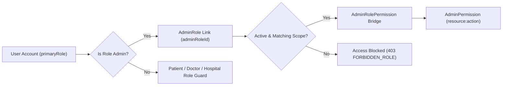
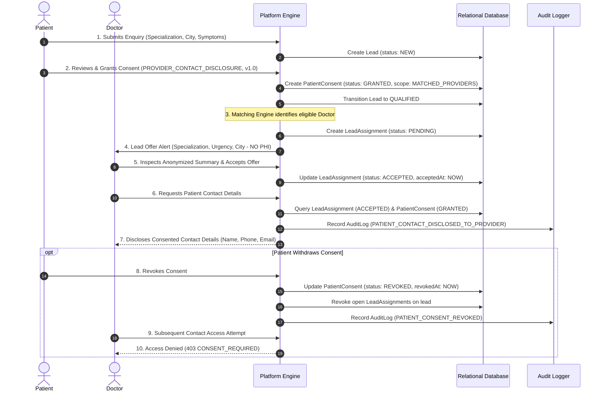
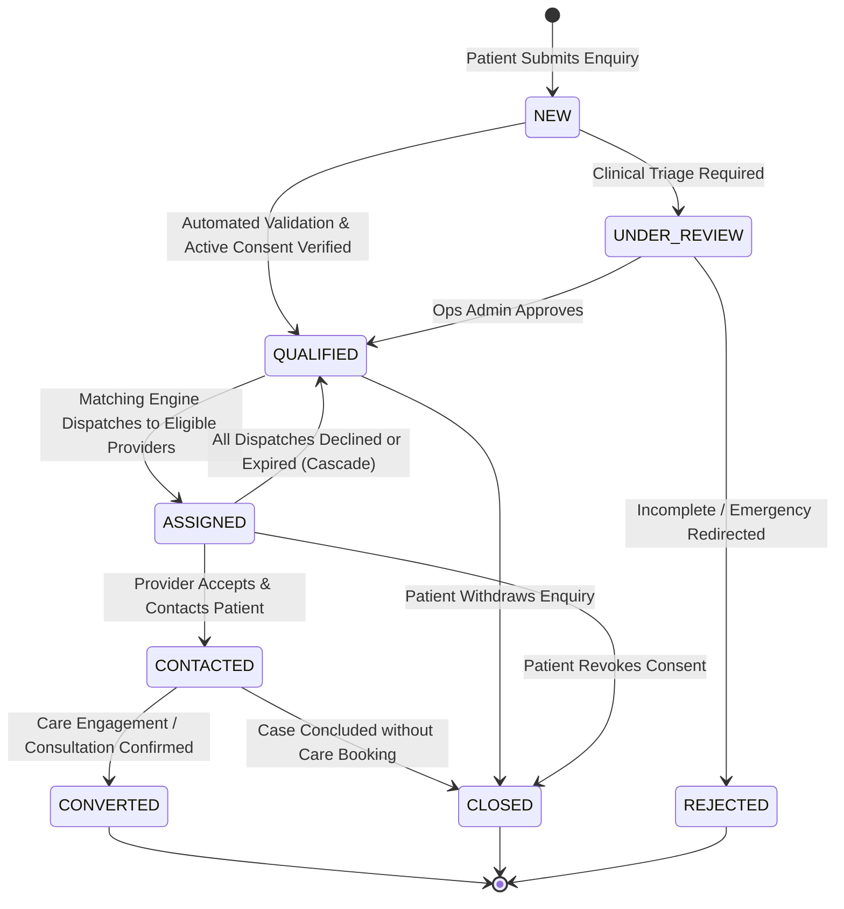
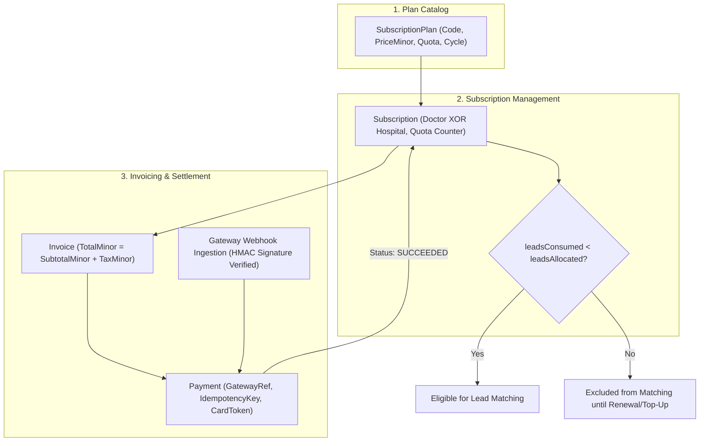
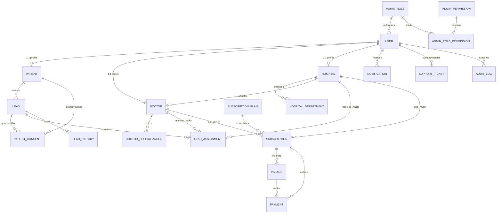

# Healthcare Lead Generation Platform — Full System Architecture

> **Classification:** Production Healthcare SaaS Architecture Specification  
> **Stack:** Next.js 15 (App Router, Server Actions, Route Handlers), TypeScript, Prisma ORM, SQLite / PostgreSQL, Auth.js (v5), Tailwind CSS  
> **Status:** Authoritative Full Architecture Blueprint (Steps 1 & 2 Foundation Established)

---

## 1. Executive Summary & Core Architectural Principles

The **Healthcare Lead Generation Platform** is a specialized, multi-tenant digital health gateway designed to connect patients seeking specialized medical care with verified healthcare providers (**Doctors** and **Hospitals**). The platform orchestrates the complete lifecycle: clinical enquiry submission, automated triage, emergency risk screening, provider qualification, deterministic matching, SLA-enforced assignment dispatch, explicit patient consent tracking, progressive disclosure of Protected Health Information (PHI), and provider subscription billing.

```mermaid
flowchart TB
    subgraph ExternalActors["Platform Actors"]
        PatientActor["Patient User"]
        DoctorActor["Doctor Provider"]
        HospitalActor["Hospital Provider (Admin/Staff)"]
        AdminStaff["Platform Admins (Super/Ops/Finance/Support)"]
    end

    subgraph PlatformBoundary["Healthcare Lead Generation Platform Boundary"]
        AppRouter["Next.js 15 Full-Stack Application (frontend/)"]
        AuthLayer["Auth.js v5 (Session & Identity Governance)"]
        ServiceLayer["Core Domain Services (Consent, Matching, Triage, Billing)"]
        DataLayer["Prisma ORM 6+ (Data Access & Integrity Layer)"]
        DatabaseEngine[("Relational Database (SQLite / PostgreSQL)") ]
    end

    subgraph ExternalServices["External Infrastructure & Partner Services"]
        PaymentGW["Payment Gateway (Stripe / Razorpay)"]
        NotificationGateway["Notification Gateways (Twilio / SendGrid)"]
        AuditStorage["Cold Audit Archive / SIEM"]
    end

    PatientActor -->|"Submits Enquiry, Grants Consent"| AppRouter
    DoctorActor -->|"Accepts Leads, Manages Profile"| AppRouter
    HospitalActor -->|"Manages Depts, Accepts Leads"| AppRouter
    AdminStaff -->|"Verifies Providers, Audits, Governs"| AppRouter

    AppRouter --> AuthLayer
    AppRouter --> ServiceLayer
    ServiceLayer --> DataLayer
    DataLayer --> DatabaseEngine

    ServiceLayer -->|"Tokenized Checkout & Webhooks"| PaymentGW
    ServiceLayer -->|"Transactional Email, SMS, Push"| NotificationGateway
    ServiceLayer -->|"Immutable Compliance Streaming"| AuditStorage
```

### Architectural Principles

1. **Zero-Trust PHI Isolation & Progressive Disclosure:**
   Patient contact details (email, phone, address) and detailed clinical complaints are strictly quarantined. Providers can inspect anonymized triage criteria (specialization, city, urgency, care setting, age bracket) while deciding whether to accept a lead. Full contact details are disclosed **only after** two cryptographic/relational locks pass:
   - The provider has explicitly accepted an active `LeadAssignment`.
   - The patient has an active, unrevoked, unexpired `PatientConsent` record covering that disclosure.

2. **Server-Enforced Authorization (Defense-in-Depth):**
   Client-side routing and UI checks are treated solely as user-experience conveniences. Security is enforced at:
   - **Edge/Route Layer:** Auth.js session token decryption, active status validation, and account suspension checks.
   - **Service Layer:** Procedural and transactional RBAC guards checking the live database state (`User.accountStatus`, `AdminRole.isActive`, `AdminRolePermission`).
   - **Database Layer:** Relational foreign keys (`onDelete: Restrict`), unique constraints, SQLite `CHECK` constraints, and partial unique indexes.

3. **Deterministic Financial & Matching Integrity:**
   - No floating-point math for money: all monetary columns (`priceMinor`, `amountMinor`, `subtotalMinor`, `taxMinor`, `totalMinor`) use integer minor units (`Int` cents/paise) paired with ISO-4217 currency codes.
   - Zero raw payment card data: no PAN, CVV, or expiry dates are processed or stored on platform servers.
   - Append-only auditability: state transitions (`LeadHistory`) and compliance entries (`AuditLog`) are structurally immutable.

---

## 2. Layered Architecture & Subsystem Boundaries

The system follows a clean **Layered Monolith** pattern with explicit modular boundaries, allowing frictionless vertical scaling and straightforward decomposition into microservices if needed in future enterprise phases.

```mermaid
flowchart TD
    subgraph PresentationLayer["1. Presentation Layer (Next.js 15 App Router)"]
        PatientPortal["Patient Portal (/patient/*)"]
        DoctorPortal["Doctor Portal (/doctor/*)"]
        HospitalPortal["Hospital Portal (/hospital/*)"]
        AdminDashboard["Admin Unified Console (/admin/*)"]
        PublicCatalog["Public Directory & Policy Catalog"]
        RouteHandlers["API Route Handlers (/api/v1/*, /api/health)"]
    end

    subgraph AuthLayer["2. Security & Identity Boundary"]
        NextAuth["Auth.js v5 (JWT & Credentials Engine)"]
        PasswordModule["Bcrypt Password Hashing (Cost 12)"]
        RBACGuard["Server RBAC & Permission Resolver"]
        SecretIsolation["Server-Only Env Guard (getServerEnv)"]
    end

    subgraph ServiceLayer["3. Core Domain & Business Logic"]
        TriageService["Lead Intake & Safety Triage"]
        ConsentService["Patient Consent Governance"]
        MatchingEngine["Deterministic Provider Matching Engine"]
        AssignmentService["Transactional Assignment & SLA Dispatcher"]
        ProviderKYCService["Doctor & Hospital Verification Engine"]
        BillingService["Subscription Quota & Invoicing Service"]
        AuditService["Recursive PHI Redacting Audit Logger"]
    end

    subgraph DataAccessLayer["4. Persistence & Data Integrity"]
        PrismaClient["Prisma ORM Client Singleton"]
        TxManager["Atomic Transaction Manager (prisma.$transaction)"]
        ConstraintEnforcer["SQLite / PostgreSQL CHECK & Partial Indexes"]
    end

    subgraph StorageEngine["5. Physical Storage"]
        PrimaryDB[("Relational Database (dev.db / PostgreSQL)")]
    end

    PresentationLayer --> AuthLayer
    PresentationLayer --> ServiceLayer
    AuthLayer --> ServiceLayer
    ServiceLayer --> DataAccessLayer
    DataAccessLayer --> StorageEngine
```



---

## 3. Subsystem Breakdown

### 3.1 Identity & Access Management (IAM)
- **Engine:** Auth.js v5 (`next-auth`) configured with JWT session strategy and 8-hour session lifetime.
- **Credential Storage:** Bcrypt password hashing (`BCRYPT_ROUNDS = 12`) with minimum 12-character passphrase policy. Plaintext passwords never reach storage or logs.
- **Account Status State Machine:** Every authenticated request re-validates `User.accountStatus`:
  - `PENDING_VERIFICATION`: Restricted to onboarding / verification submission.
  - `ACTIVE`: Full permitted platform access.
  - `SUSPENDED` / `DEACTIVATED`: Immediate revocation across all endpoints.
  - `deletedAt IS NOT NULL`: Account treated as nonexistent.

### 3.2 Administrative Governance & Dual-Tier RBAC
Platform administration separates duties across four distinct administrative roles:



| Role Code | Operational Domain | PHI Access Scope | Billing / Commercial Scope |
| :--- | :--- | :--- | :--- |
| **`SUPER_ADMIN`** | Full platform governance, role assignment, system configuration, break-glass | Unrestricted (audited) | Full plan & invoice control |
| **`OPERATIONS_ADMIN`** | Doctor/hospital KYC verification, manual lead triage, re-assignment | Operational triage only | Read-only provider eligibility |
| **`FINANCE_ADMIN`** | Subscription plans, quota management, invoices, refunds, reconciliations | **ZERO PHI ACCESS** | Full commercial ledger control |
| **`SUPPORT_ADMIN`** | User tickets, customer troubleshooting, communication assistance | Masked ticket context only | Zero invoice mutation |

### 3.3 Provider Management & Verification Subsystem
1. **Entities:** `Doctor`, `Hospital`, `HospitalDepartment`, `DoctorSpecialization`.
2. **KYC Gate:** Providers register in `PENDING` verification status.
3. **Verification Process:** Operations Admins review registration licenses, authority records, and accreditation numbers.
4. **Lead Acceptance Lock:** Providers **cannot** enable `isAcceptingLeads = true` until `verificationStatus = 'VERIFIED'`.

### 3.4 Patient Consent & PHI Protection Subsystem
The platform strictly decouples intake enquiry fields from identifiable patient demographics:



---

## 4. Lead Generation, Qualification & Matching Engine

### 4.1 Lead Lifecycle State Machine



### 4.2 Matching Algorithm & Eligibility Filters

When a lead transitions to `QUALIFIED`, the matching engine executes a two-stage evaluation:

#### Stage 1: Hard Eligibility Filters (Binary Boolean Pass/Fail)
1. **Verification Gate:** `provider.verificationStatus === 'VERIFIED'` and `user.accountStatus === 'ACTIVE'`.
2. **Acceptance Gate:** `provider.isAcceptingLeads === true` (and for hospitals, `hospitalDepartment.isAcceptingLeads === true`).
3. **Clinical Specialization:**
   - **Doctor:** `DoctorSpecialization` matches `lead.specialization`.
   - **Hospital:** `HospitalDepartment` matches `lead.specialization`.
4. **Geographic & Mode Compatibility:**
   - If `lead.consultationMode === 'IN_PERSON'`: provider country, state, and city match (or within geographic distance radius).
   - If `lead.consultationMode === 'TELECONSULTATION'`: provider offers teleconsultation.
5. **Subscription & Quota Availability:**
   - Active subscription: `status IN ('ACTIVE', 'TRIALING')` and `currentPeriodEnd > NOW()`.
   - Remaining quota: `leadsConsumedInPeriod < leadsAllocatedInPeriod`.
6. **No Duplicate or Active Cooldown:** Provider does not currently hold a `PENDING` or `ACCEPTED` assignment for this `leadId`.

#### Stage 2: Multi-Factor Match Score Formula ($0.00$ to $100.00$)

$$\text{Score} = w_{\text{spec}} \cdot S_{\text{spec}} + w_{\text{geo}} \cdot S_{\text{geo}} + w_{\text{sla}} \cdot S_{\text{sla}} + w_{\text{load}} \cdot S_{\text{load}}$$

| Component | Weight | Criteria |
| :--- | :---: | :--- |
| **Specialization Alignment ($S_{\text{spec}}$)** | $40\%$ | Primary specialty & board-certified ($100$), Secondary specialty ($75$), Parent discipline ($50$). |
| **Geographic Proximity ($S_{\text{geo}}$)** | $30\%$ | Same city ($100$), adjacent city within state ($70$), teleconsultation match ($85$). |
| **Historical Responsiveness ($S_{\text{sla}}$)** | $20\%$ | Ratio of accepted-to-expired assignments and mean response latency over trailing 90 days. |
| **Fairness & Quota Utilization ($S_{\text{load}}$)** | $10\%$ | Balances assignment volume among eligible providers with high remaining quota. |

Assignments are dispatched in transactional batches, respecting `PatientConsent.maxProviderDisclosures` (typically 1 to 3 providers).

---

## 5. Commercial, Subscription & Tokenized Billing Subsystem



- **Quota Tracking:** Atomic increment of `leadsConsumedInPeriod` upon lead assignment acceptance.
- **PCI Scope Minimization:** Payments are settled via hosted checkout sessions or tokenized methods (`CARD_TOKEN`, `UPI`, `ACH`, `WIRE`). Raw primary account numbers (PAN) and CVV codes are never handled by platform servers.
- **Idempotency:** Gateway webhook events and checkout requests enforce unique `idempotencyKey` checks to eliminate duplicate charges.

---

## 6. Complete Data Architecture & Relational Topology

The 20 normalized relational models are mapped across 5 functional clusters:



### Relational Integrity Matrix

| Entity | Primary Key | Foreign Key Relations | Key Integrity Constraints & Partial Indexes |
| :--- | :--- | :--- | :--- |
| `User` | UUIDv4 | `adminRoleId` → `AdminRole` | `@unique` on `email`, `phone`; indexed on role, status, deletion. |
| `AdminRole` | UUIDv4 | None | `@unique` on `code` (`SUPER_ADMIN`, `OPERATIONS_ADMIN`, etc.). |
| `AdminPermission` | UUIDv4 | None | `@unique` on `code`; `@unique` on `(resource, action)`. |
| `AdminRolePermission` | UUIDv4 | `adminRoleId`, `permissionId` | `@@unique([adminRoleId, permissionId])`. |
| `Patient` | UUIDv4 | `userId` → `User` (1:1) | `onDelete: Restrict`; indexed location & archival. |
| `Hospital` | UUIDv4 | `userId` → `User` (1:1) | `@@unique([countryCode, registrationNumber])`; composite eligibility index. |
| `HospitalDepartment` | UUIDv4 | `hospitalId` → `Hospital` | `@@unique([hospitalId, specializationCode])`. |
| `Doctor` | UUIDv4 | `userId`, `primaryHospitalId` | `@@unique([licenseCountryCode, medicalLicenseNumber])`; composite eligibility index. |
| `DoctorSpecialization` | UUIDv4 | `doctorId` → `Doctor` | `@@unique([doctorId, specializationCode])`. |
| `Lead` | UUIDv4 | `patientId` → `Patient` | `@@unique([patientId, idempotencyKey])`; indexed status, priority, geo. |
| `LeadAssignment` | UUIDv4 | `leadId`, `doctorId`, `hospitalId` | Exclusive XOR (`Doctor` vs `Hospital`); partial unique index prevents duplicate active offers. |
| `LeadHistory` | UUIDv4 | `leadId`, `assignmentId`, `actorUserId` | Indexed transition journal; immutable audit trail. |
| `PatientConsent` | UUIDv4 | `patientId`, `leadId`, `doctor`, `hospital` | Indexed `[patientId, leadId, status]`; records grant/revocation timestamps & IP hash. |
| `SubscriptionPlan` | UUIDv4 | None | `@unique` on `code`; price/quota integer validation. |
| `Subscription` | UUIDv4 | `planId`, `doctorId`, `hospitalId` | Exclusive XOR (`Doctor` vs `Hospital`); quota consumption constraint. |
| `Invoice` | UUIDv4 | `subscriptionId`, `doctorId`, `hospitalId` | Exclusive XOR; `totalMinor = subtotalMinor + taxMinor`. |
| `Payment` | UUIDv4 | `subscriptionId`, `invoiceId`, `doctor`, `hospital` | Exclusive XOR; `@unique` on `idempotencyKey`; no raw card details. |
| `Notification` | UUIDv4 | `recipientUserId` → `User` | `onDelete: Cascade`; indexed recipient inbox. |
| `SupportTicket` | UUIDv4 | `requesterUserId`, `assignedAdminUserId`, `leadId` | `@unique` on `ticketNumber`; multi-tenant support queuing. |
| `AuditLog` | UUIDv4 | `actorUserId` → `User` | `onDelete: SetNull`; immutable compliance logging. |

---

## 7. Security, Privacy & Regulatory Compliance (HIPAA / DPDP)

1. **PHI Minimization:** Lead forms capture only high-level medical concerns. In-depth clinical charts and medical history are never ingested into the lead generation tier.
2. **Server-Side Secret Isolation:** Database URLs and Auth.js signing keys are validated exclusively in server memory (`getServerEnv()`) and never exposed in browser bundles or `NEXT_PUBLIC_*` variables.
3. **Cryptographic Integrity:** Signatures on authentication tokens, webhooks, and password hashes employ industry-standard primitives (Bcrypt, HMAC-SHA256, Ed25519/RSA where applicable).
4. **Auditability & Non-Repudiation:** Sensitive actions (consent grant, consent revocation, provider viewing contact details, KYC verification approval/rejection, admin role grant) trigger synchronous `AuditLog` entries with sanitized metadata.

---

## 8. Scalability & Production Roadmap

```mermaid
flowchart LR
    subgraph Phase1["Phase 1 & 2 (Established Foundation)"]
        direction TB
        F1["Next.js 15 Full-Stack App"]
        F2["Prisma ORM with SQLite (dev.db)"]
        F3["Auth.js v5 JWT Engine"]
        F4["20 Relational Models & Integrity Gates"]
    end

    subgraph Phase3["Phase 3: Domain APIs & Business Workflows"]
        direction TB
        B1["Patient Lead Intake & Consent Actions"]
        B2["Operations KYC & Manual Qualification"]
        B3["Automated Matching & Assignment Dispatch"]
        B4["Provider Lead Acceptance & Contact Views"]
    end

    subgraph Phase4["Phase 4: Production Hardening & Scale"]
        direction TB
        P1["PostgreSQL Multi-AZ Cluster (Read Replicas)"]
        P2["BullMQ + Redis Background SLA Workers"]
        P3["Payment Gateway Webhook Verification"]
        P4["Multi-Channel Dispatch (SMS / Email / Push)"]
    end

    Phase1 --> Phase3
    Phase3 --> Phase4
```



- **Database Engine Portability:** Because all models use UUIDv4 strings, ISO-4217 currency pairs, and standard relations, migrating from local SQLite (`dev.db`) to enterprise PostgreSQL requires changing only the `datasource db` provider in `schema.prisma`.
- **Background Jobs:** Asynchronous SLA timers (expiring unaccepted lead offers after 24–48 hours) and batch re-matching cascade loops will transition from Next.js Route Handlers to dedicated queue workers (e.g. BullMQ on Redis).
- **Zero-Dummy-Data Guarantee:** The system transitions from foundation to production with an empty, verified database ready for genuine user registration and verified provider onboarding.
